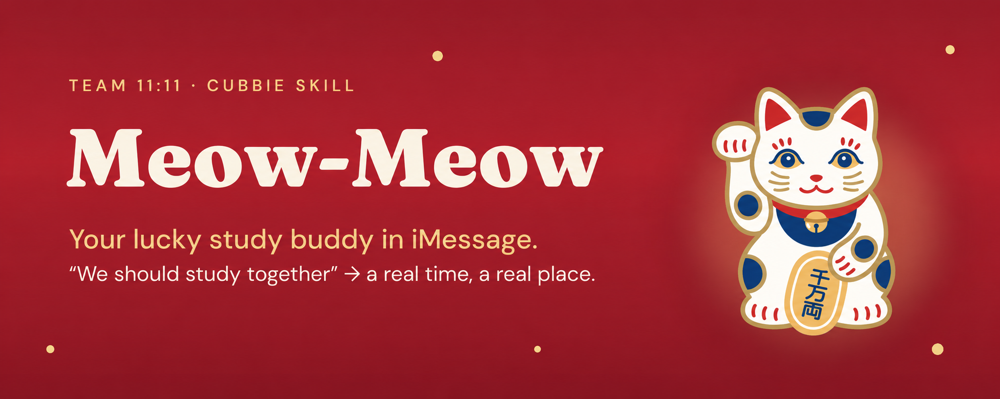
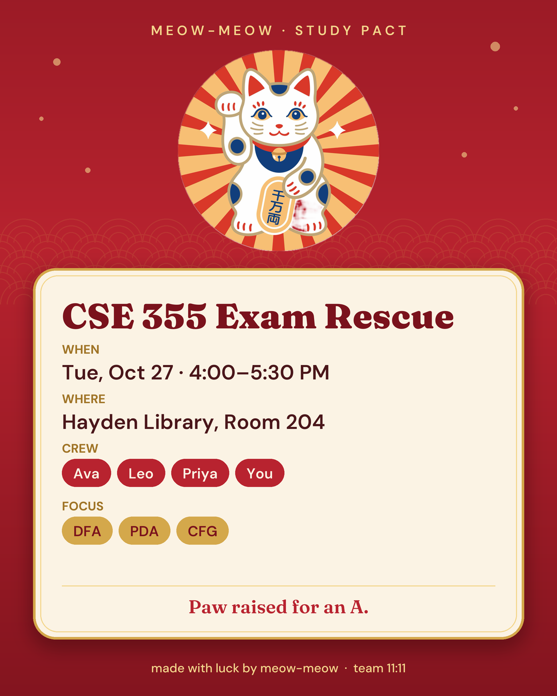

<p align="center">
  
</p>

<h3 align="center">"We should study together" → a real time, a real place, a crew that shows up.</h3>

<p align="center"><b>A Cubbie Skill by team 11:11</b></p>

---

## The moment

It's Sunday. The exam is Wednesday. The group chat says *"we should study together 🙏"*, everyone says
*"I'm free sometime"*, and nothing happens.

**Meow-Meow fixes that in one text.** It's a maneki-neko, the Japanese lucky cat with its paw raised, living
inside Cubbie in your iMessage.

## How it works

1. **You text:** `meow-meow, set up CSE 355 study with Ava and Leo before Wednesday's exam`
2. **It checks your calendar** and drafts one group text asking your friends when they're free.
3. **You paste their replies** (or screenshot them). Meow-Meow does the time math, exactly, not by guessing.
4. **You pick** from the best options. No time fits everyone? It shows who'd miss each one and offers a fix.
5. **It sends you a study pact:** a red-and-gold card plus a calendar invite the whole crew can tap to add.

<p align="center">
  
</p>

```text
You:        meow-meow, CSE 355 study w/ Ava, Leo, Priya before Wed's exam
Meow-Meow:  On it 🐾 Send this to the crew:
            "When are you free Mon–Tue? Like 'Mon after 5, Tue 3-7'"
You:        [pastes replies]
Meow-Meow:  Everyone's free Tue 3:30–5 PM.
            Hayden Library has rooms. Want me to book one?
You:        yes
Meow-Meow:  [study pact card] [invite.ics]
            Locked in. Forward these to the crew. Paw raised for you.
```

## Install

Text this link to Cubbie:

```
https://github.com/aditipatel1/meow-meow-cubbie/tree/main/meow-meow
```

## Why it's built this way

- **The math is real.** `scripts/find_time.py` intersects everyone's free and busy blocks in 30-minute steps,
  ranks comfortable hours first, and spreads options apart. The AI reads messages; it never picks a time by eye.
- **It respects your friends.** Cubbie only texts you. Meow-Meow drafts the messages and you send them.
- **Nothing happens without your yes.** No bookings, invites or calendar changes until you confirm.
- **The card is made fresh for every plan.** `scripts/card.py` renders it with Pillow and bundled open-licensed
  fonts (Fraunces and DM Sans, SIL OFL).

## Try it locally

```bash
python3 meow-meow/scripts/find_time.py slots --sample
pip install pillow==11.3.0 && python3 meow-meow/scripts/card.py --sample --out card.png
```

## Team 11:11

Built at the Cubbie Hackathon, Track 1. Make a wish at 11:11, and let the cat handle the scheduling.
